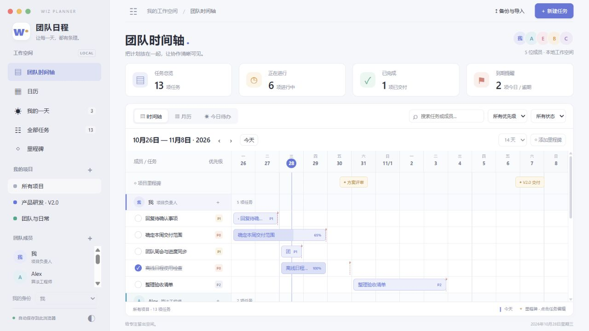

# Wiz Planner · 团队日程

[](LICENSE)
[](https://github.com/Wizcoo/wiz-planner/actions/workflows/ci.yml)

A macOS-inspired, local-first team planner with Gantt timelines, calendars, daily to-dos, and portable HTML backups.

**No account. No cloud. One HTML file.** Download this repository, open `index.html` in a modern browser, and start planning. Changes are stored in your browser; export JSON or a self-contained HTML snapshot for a portable backup. The current UI is in Chinese. This is a local planning tool, without live multi-user synchronization.



偏 macOS 日历与提醒事项风格的本地团队任务管理工具。浅灰侧栏、柔和配色、可切换深色外观。无需账号，离线可用。

## 直接打开

双击根目录 **`index.html`**，或双击 **`open-planner.bat`**。不需要 Node.js，也不需要联网。首次打开包含可编辑的演示数据。

需要从空白开始时：右上角 **备份与导入 → 创建空白工作区**，确认后添加项目、成员，再添加任务。

## 已实现

- **甘特时间轴**：按成员/角色分组，每位成员可创建多个任务；7 / 14 / 30 天范围、前后翻页、定位今天；拖动任务条调整计划起止日期。
- **月历**：周一开始的完整月视图；显示跨天任务、截止日期和里程碑；点击日期新建，点击任务编辑。
- **我的一天**：在左下角选择“我的身份”，自动列出逾期、今天要做、接下来、今天已完成；勾选即可完成，也可重新打开任务。
- **任务编辑**：负责人、项目、计划起止日期、独立 Deadline、P0/P1/P2、状态、进度、颜色和备注。
- **项目 / 成员管理**：点击左侧 ＋ 新建；悬停点击 ··· 编辑名称、角色、颜色或删除空项目/空成员。有关联任务时必须先转移任务。
- **里程碑**：可作为项目节点或关联某个任务，编辑日期并标记达成；在时间轴、月历与独立列表中查看。
- **筛选**：项目、成员、优先级、状态与关键词组合筛选。
- **保存**：浏览器自动保存、JSON 导入/导出、导出带完整数据的单文件 HTML；Ctrl/Cmd + S 保存 JSON。

## 保存与迁移

1. **自动保存**写入当前浏览器的 `localStorage`，刷新页面后保留。若浏览器禁用存储或空间不足，页面会明确显示未保存，并提示导出文件。
2. **保存 JSON 备份**才是磁盘文件备份。浏览器支持时可选择文件位置；否则下载到默认下载目录。
3. **导出带数据的 HTML**会把当前全部数据装入新文件。该文件拥有独立工作区标识，避免被另一份文件的缓存覆盖。
4. **从 JSON 恢复**会先检查版本、日期、颜色、重复 ID 和关联关系，再显示数量等待确认；无效文件不会替换现有数据。
5. HTML 文件本身不会随编辑自动改写。清理浏览器、换电脑、换浏览器或移动文件前，请先导出 JSON / HTML。`file://` 存储隔离规则取决于浏览器，文件备份是迁移依据。
6. 同一来源多个窗口修改时会暂停冲突窗口的自动保存，提示先导出再刷新，避免静默覆盖。

这是**本地团队排期工具**，方便一个人管理团队任务；没有多人实时同步、登录或权限管理。给同事的 HTML / JSON 是独立副本。

## 日期与待办规则

- 日期按使用电脑的本地日历计算；计划开始、结束日期都包含当天。
- Deadline 与计划结束日分开保存。拖动甘特条只移动计划日期，不移动 Deadline。
- 未设置 Deadline 时，以计划结束日作为到期提醒依据。
- 已开始但未完成的任务会持续留在待办；超过截止日后归入“需要跟进”。
- “今天已完成”按勾选完成的实际日期记录；历史已完成任务仍可在“全部任务”中查看。
- P0：紧急重要；P1：优先处理；P2：常规安排。

## 原版项目与数据库

原 Next.js / SQLite 代码继续保留，原数据库 `wiz_timeline.db` 不被离线版修改。

```powershell
npm install
npm run dev
```

- `http://localhost:3000`：新版离线工具入口。
- `http://localhost:3000/legacy`：原版数据库甘特图。
- 新版“备份与导入 → 导入原版数据库”可读取原 API，确认后导入当前浏览器。旧 `urgent/high` 转为 P0，`medium` 转为 P1，`low` 转为 P2；原结束日作为初始 Deadline。
- 双击 HTML 与 localhost 页面属于不同存储位置；两者之间通过 JSON 迁移数据。

原说明保存在 `docs/README-legacy.md`。

## 开发

```text
planner/template.html   页面结构
planner/style.css       样式与响应式布局
planner/core.mjs        日期、验证、筛选、示例与旧数据转换
planner/app.js          界面交互和本地存储
scripts/build-planner.mjs 生成两个一致的独立 HTML 入口
index.html             双击打开的交付文件
public/team-planner.html  Next.js 提供的静态版本
```

修改 `planner/` 后运行 `npm run planner:build`。不要手改生成的 HTML；`npm run dev` 和 `npm run build` 也会自动生成。

```powershell
npm run planner:build
npm test
npm run test:planner
npm run typecheck
npm run build
```

开发和测试建议使用 Node.js 24。`npm test` 自动在 `.qa/` 下创建隔离测试目录并串行运行全部测试，不会读写工作区的业务数据库。直接运行原版数据库测试文件时，它们仍会在当前工作目录创建 SQLite 文件。

## Contributing & License

Issues and pull requests are welcome. See [CONTRIBUTING.md](CONTRIBUTING.md) for the development workflow.

Released under the [MIT License](LICENSE). Third-party dependencies retain their own licenses.
